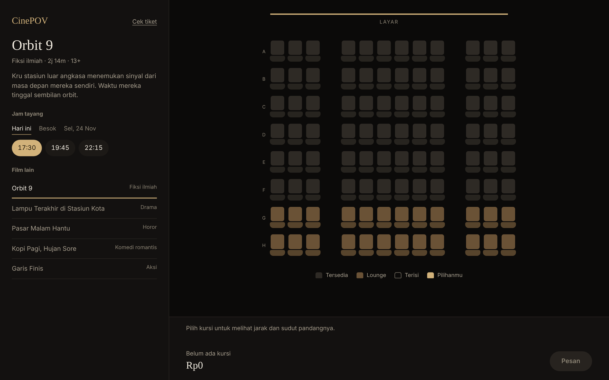
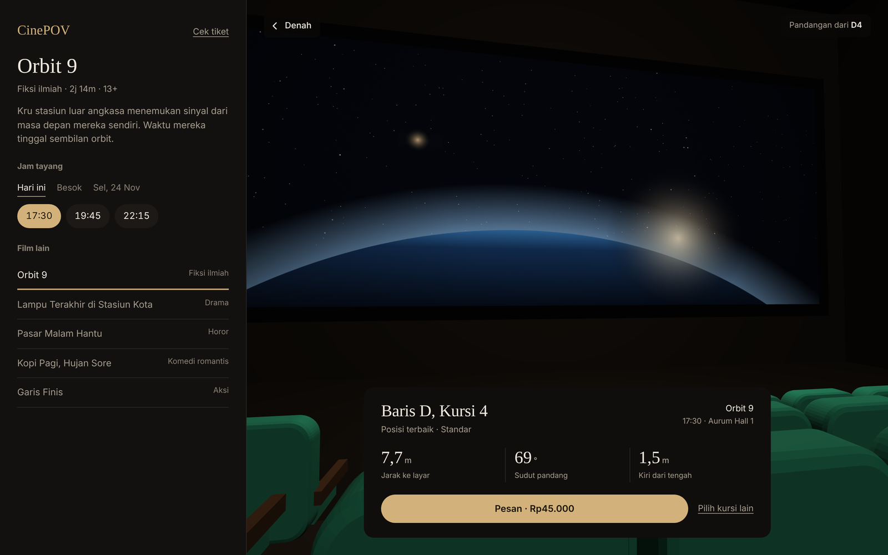
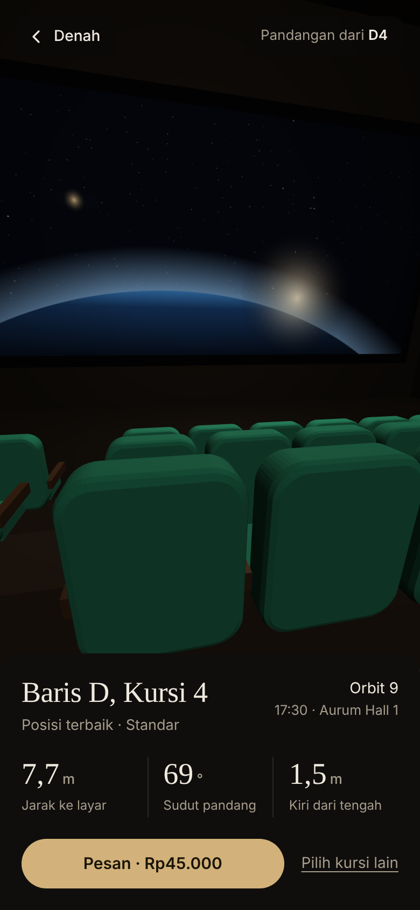
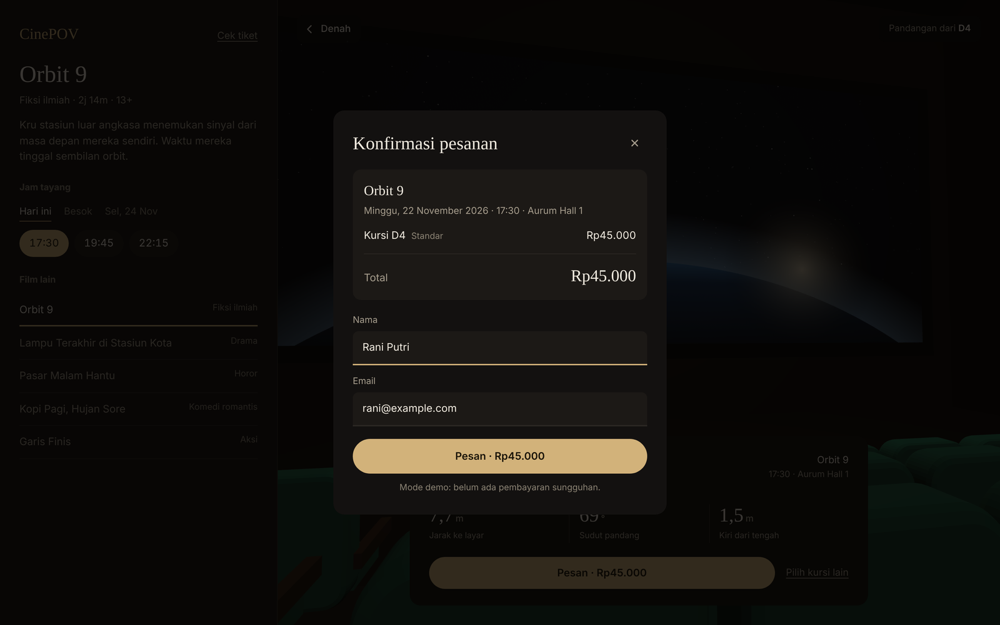
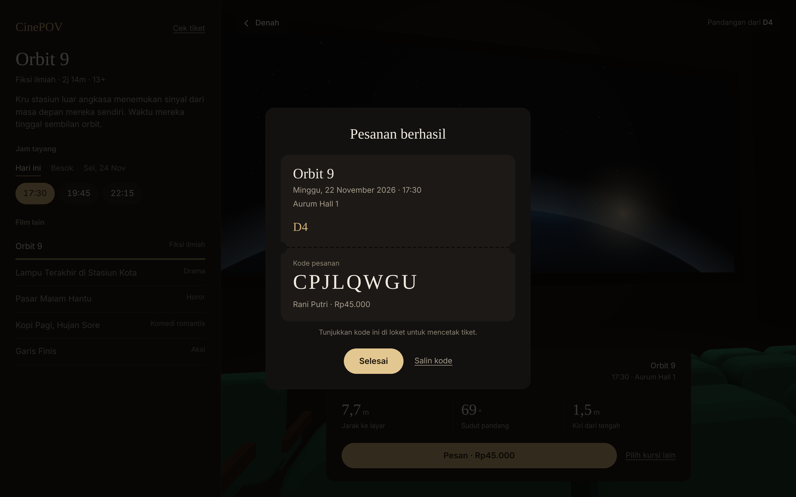

# CinePOV

**Pilih kursi bioskop sambil melihat langsung pandangan dari kursi itu.**

CinePOV adalah aplikasi web pemesanan kursi bioskop. Begitu kursi diketuk, kamera 3D terbang dari tampak atas denah ke sudut pandang orang pertama dari kursi tersebut, lengkap dengan jarak ke layar, sudut pandang, posisi terhadap tengah, info film, dan harga tiket. Jadi pengguna tahu persis apa yang akan mereka lihat sebelum membayar.

> Proyek portofolio. Semua film, studio ("Aurum Hall"), dan aset visual adalah fiktif dan dibuat sendiri.



## Fitur

- **Transisi kamera 3D**: denah 2D → penerbangan kamera → POV dari kursi (dan sebaliknya), dengan timing yang disetel manual.
- **Data pandangan per kursi**: jarak ke layar (m), sudut pandang (°), selisih dari tengah (m), dan zona kursi.
- **Multi-kursi**: pilih sampai 6 kursi dalam satu pesanan.
- **Kursi Lounge**: baris belakang dengan tambahan harga Rp30.000.
- **Anti dobel booking**: kursi yang sudah dipesan orang lain ditolak server (HTTP 409), dan denah menyegarkan diri tiap 20 detik.
- **Pesan & cek tiket**: isi nama + email, dapat kode pesanan, lalu cari ulang lewat "Cek tiket".
- **Responsif**: desktop memakai panel kiri + panggung; mobile memakai header ringkas dan bottom sheet.
- **Aksesibilitas**: bisa dipakai dengan keyboard, atribut ARIA pada denah dan dialog, Escape menutup dialog, dan menghormati `prefers-reduced-motion`.

| Denah → POV (desktop) | POV (mobile) |
| --- | --- |
|  |  |

| Form pemesanan | Tiket |
| --- | --- |
|  |  |

## Teknologi

| Lapisan | Pilihan |
| --- | --- |
| Frontend | React 19, Vite 8, Three.js, CSS biasa dengan design token |
| Backend | Python 3, Flask, flask-cors |
| Database | SQLite (modul `sqlite3` bawaan Python) |
| Tipografi | Bodoni Moda + Hanken Grotesk (Google Fonts) |

## Cara kerja singkat

- **Geometri dipakai bersama.** Rumus posisi kursi (lebar lorong, jarak baris, tinggi lantai, sudut layar) ada di backend dan `frontend/src/lib/geometry.js` dengan hasil identik. Backend menghitung jarak/sudut/offset per kursi, frontend memakai rumus yang sama untuk membangun adegan 3D.
- **Kamera sejajar denah.** Posisi kamera tampak atas dihitung dari posisi piksel kursi di DOM, sehingga adegan 3D tepat menimpa denah 2D sebelum penerbangan dimulai.
- **Harga dihitung di server.** Klien hanya mengirim daftar kursi; total dihitung ulang di backend.
- **Integritas data.** Constraint `UNIQUE(showtime_id, row_label, col)` di SQLite mencegah dua pesanan mengambil kursi yang sama walau request datang bersamaan.
- **Query terparameter** di semua endpoint (aman dari SQL injection).

## Menjalankan di lokal

Butuh Python 3.10+ dan Node.js 20.19+.

### 1. Backend (port 5050)

```bash
cd backend
python -m venv .venv
# Windows: .venv\Scripts\activate    macOS/Linux: source .venv/bin/activate
pip install -r requirements.txt
python seed.py        # membuat cinepov.db berisi film, studio, jadwal
python app.py         # http://127.0.0.1:5050
```

### 2. Frontend (port 5173)

```bash
cd frontend
npm install
npm run dev           # http://localhost:5173
```

Vite mem-proxy `/api` ke `http://127.0.0.1:5050`, jadi backend harus jalan lebih dulu.

### Tes API

```bash
cd backend
python seed.py
python test_api.py    # menjalankan 11 pengecekan terhadap endpoint
```

## Endpoint API

| Method | Path | Fungsi |
| --- | --- | --- |
| GET | `/api/health` | Cek server hidup |
| GET | `/api/movies` | Daftar film |
| GET | `/api/movies/<id>` | Detail film + jadwal tayang mendatang |
| GET | `/api/showtimes/<id>` | Jadwal, film, dan studio |
| GET | `/api/showtimes/<id>/seats` | Semua kursi + status terisi, harga, jarak, sudut, offset |
| POST | `/api/bookings` | Buat pesanan → `201 {"code"}`; `400` validasi; `409` kursi sudah diambil |
| GET | `/api/bookings/<code>` | Ambil tiket berdasarkan kode |

## Struktur proyek

```
cinepov/
├── backend/
│   ├── app.py            # Flask API
│   ├── seed.py           # data awal (film, studio, jadwal)
│   ├── test_api.py       # tes endpoint
│   └── requirements.txt
├── frontend/
│   └── src/
│       ├── App.jsx       # state utama & alur map → POV
│       ├── api.js        # pembungkus fetch
│       ├── components/   # Rail, SeatPlan, PovLayer, BookBar, CheckoutDialog, Ticket, LookupDialog
│       ├── lib/          # geometry, hall3d (Three.js), stills, format
│       └── styles/       # tokens, base, layout, seatplan, pov, checkout
└── docs/screenshots/
```

## Catatan desain

Arah visualnya gelap dan elegan dengan aksen kuningan (`#D2B27A`) di atas latar hampir hitam, tipografi serif untuk judul. Bentuk, warna, dan layar film dibuat orisinal, tidak meniru merek atau aset bioskop mana pun.

## Rencana berikutnya

- Login dan riwayat pesanan
- Payment gateway sungguhan (saat ini tiket langsung terbit tanpa pembayaran)
- Panel admin untuk film dan jadwal
- Deploy (frontend statis + backend Flask)

## Lisensi

Belum ditentukan. Tambahkan file `LICENSE` (misalnya MIT) sebelum dipublikasikan.

---

Dibuat oleh **Kazuhiro Gerarudi Yamazaki** · [GitHub](https://github.com/yamazakidesu) · Demo: _segera_
